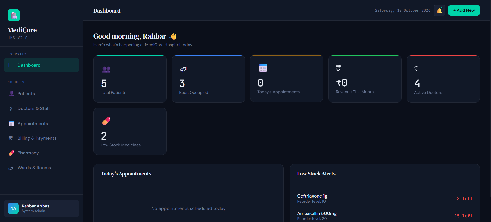
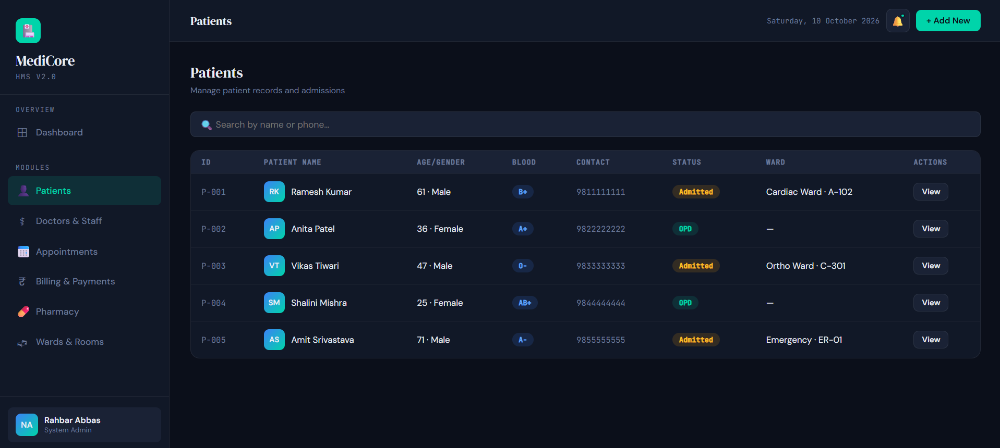
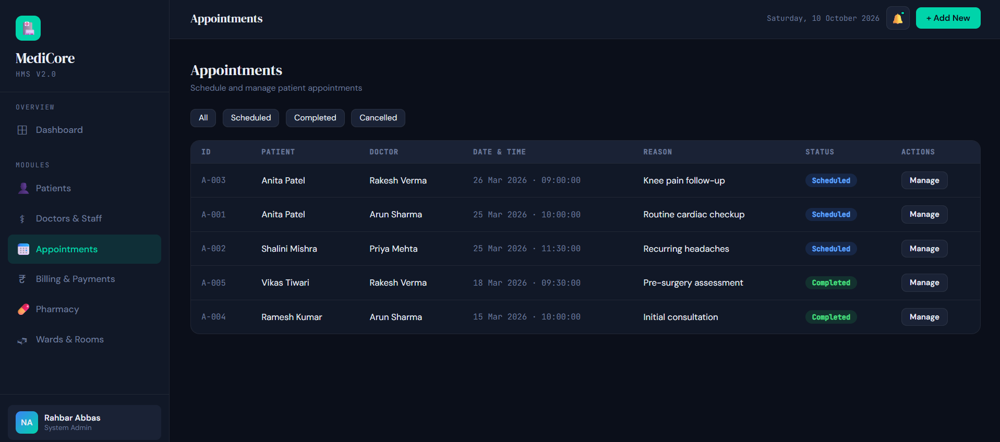
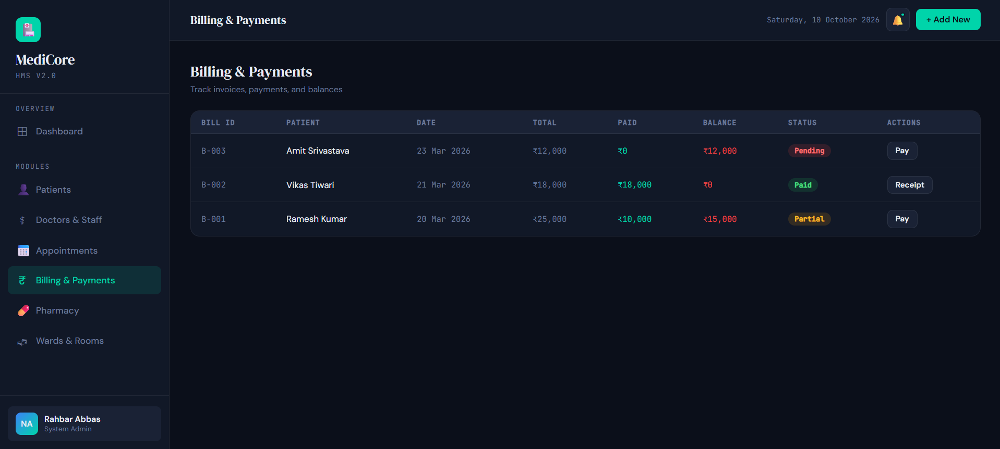
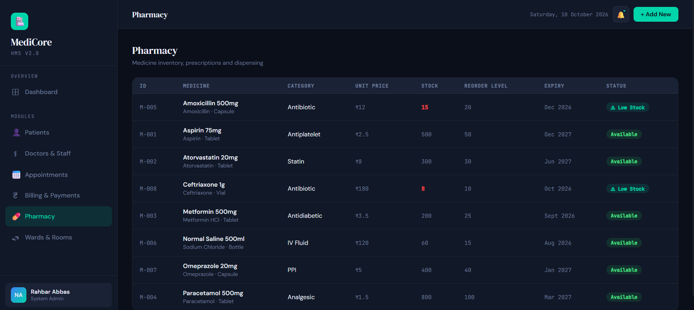

# MediCore Hospital Management System

## Project Overview

The **MediCore Hospital Management System** is a database-focused project designed to manage common hospital operations through a relational MySQL database integrated with a Flask-based web application.

The project covers hospital data such as patients, doctors and staff, appointments, wards and rooms, pharmacy inventory, billing and payments.

The primary focus of this project was **relational database design and SQL implementation using MySQL**.

---

## My Contribution

- Designed and worked with the relational **MySQL database and SQL logic**.
- Created and worked with tables, primary keys, foreign keys, relationships, views, and sample hospital data.
- Used SQL to manage and retrieve information across different hospital modules.
- Integrated the database with the application to display hospital information through the interface.
- Used **AI-assisted guidance for parts of the Flask/Python backend and HTML/CSS/JavaScript frontend development**.

This project was developed primarily to strengthen practical SQL and relational database skills.

---

## Technologies Used

| Technology | Purpose |
|---|---|
| MySQL | Relational database design and data management |
| SQL | Queries, relationships, views and database operations |
| Python | Backend application logic |
| Flask | Backend API and database integration |
| PyMySQL | MySQL connectivity from Python |
| HTML | Web interface structure |
| CSS | Interface styling and layout |
| JavaScript | Frontend interaction and API communication |

---

## Database Modules

The database includes the following major areas:

- Departments
- Wards and Rooms
- Staff and Doctors
- Patients and Admissions
- Appointments
- Pharmacy
- Billing and Payments
- Insurance Claims
- System Users

The database uses relational connections between these areas to organize hospital information.

---

## SQL Features

The SQL implementation includes:

- Primary Keys
- Foreign Keys
- Relational Tables
- Data Constraints
- Sample Data
- SQL Views
- JOIN-based relationships
- Billing and payment records
- Pharmacy stock information
- Patient admission records

The database also contains views including:

- `vw_patient_overview`
- `vw_doctor_schedule`
- `vw_outstanding_bills`
- `vw_low_stock_medicines`

---

## Application Features

The application provides modules for:

- Patient Management
- Doctors and Staff
- Appointment Management
- Billing and Payments
- Pharmacy Inventory
- Wards and Rooms
- Hospital Dashboard

The dashboard displays key hospital information such as total patients, occupied beds, appointments, active doctors, monthly revenue and low-stock medicines.

---

## Screenshots

### Dashboard



### Patient Management



### Appointment Management



### Billing & Payments



### Pharmacy Inventory



---

## Project Structure

```text
Hospital_Management_System/
│
├── Screenshots/
│   ├── Appointments.png
│   ├── Billing_Payments.png
│   ├── Dashboard.png
│   ├── Patients.png
│   └── Pharmacy.png
│
├── app.py
├── hospital_management.html
├── hospital_schema.sql
├── requirements.txt
└── README.md

```

## Running the Project

### 1. Create the Database

Open MySQL Workbench and execute:

`hospital_schema.sql`

This creates the required database structure, relationships, views, and sample data.

### 2. Install Python Dependencies

```bash
pip install -r requirements.txt

```

### 3. Configure the MySQL Connection


The application reads the MySQL password from the `HOSPITAL_DB_PASSWORD` environment variable instead of storing the password directly in the source code.

In Windows PowerShell, set the password before starting the application:

```powershell
$env:HOSPITAL_DB_PASSWORD="your_mysql_password"

```

### 4. Start the Flask Application

Run:

```bash
python app.py
```

Open the application in your browser at:

`http://127.0.0.1:5001/`


The Flask application will connect to the MySQL database and serve the hospital management interface.


## Learning Outcomes

This project helped strengthen my understanding of:

- Relational Database Design
- MySQL
- SQL Queries
- Primary and Foreign Keys
- Table Relationships
- Database Integration
- Data Retrieval and Management
- Backend-to-Database Communication
- Practical Hospital Data Management

---

## AI Assistance Disclosure

The main learning focus and contribution in this project was **MySQL database design and SQL implementation**.

AI assistance was used for parts of the **Flask/Python backend and HTML/CSS/JavaScript frontend development**.

This distinction is included to clearly represent the areas of the project that I focused on and can explain in detail.

---

## Purpose of the Project

This project was created as a practical learning project to demonstrate the use of **MySQL and relational database concepts** in a real-world-style hospital management scenario.